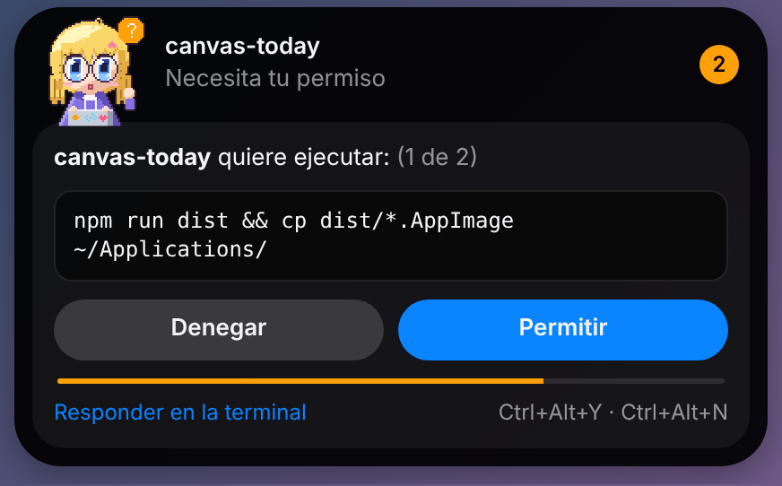
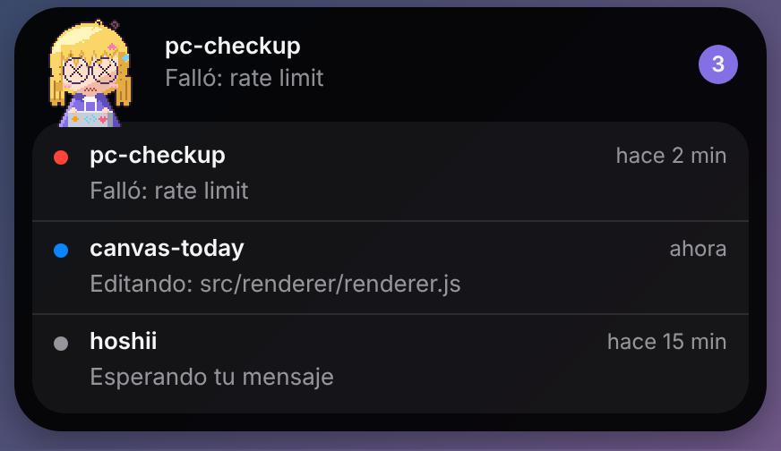

# Hoshii

Isla de escritorio para [Claude Code](https://code.claude.com) en Linux (GNOME). Una cápsula arriba al centro de la pantalla, con una mascota en pixel art, que te muestra qué hace cada sesión y te deja aprobar o denegar permisos con un clic.

<p align="center"></p>

<p align="center">
  
  
</p>

## Qué hace

- **Estado por sesión**: pensando, qué herramienta usa y sobre qué archivo o comando, esperando tu mensaje, terminó o falló. Pasa el mouse por la isla para ver todas las sesiones.
- **Permisos**: cuando Claude Code pide permiso, la isla muestra el comando o archivo completo con **Permitir**, **Denegar** o **Responder en la terminal**. También `Ctrl+Alt+Y` / `Ctrl+Alt+N`.
- **Aviso al terminar**: notificación del sistema cuando una sesión termina su turno.

No usa la API ni toca tus credenciales: Claude Code sigue usando tu cuenta como siempre y Hoshii solo recibe sus [hooks](https://code.claude.com/docs/en/hooks).

## Instalar

1. Descarga `Hoshii-<versión>.AppImage` de [Releases](https://github.com/lelrxuch/hoshii/releases) y verifica el checksum:

   ```sh
   sha256sum -c SHA256SUMS.txt --ignore-missing
   ```

2. Dale permisos de ejecución y ábrela:

   ```sh
   chmod +x Hoshii-*.AppImage
   ./Hoshii-*.AppImage
   ```

3. En la isla, pulsa **Conectar**. Hoshii agrega sus hooks a `~/.claude/settings.json` (antes guarda un respaldo `settings.json.hoshii-<fecha>.bak`) y copia el hook a `~/.local/share/hoshii/hook.py`.
4. Reinicia las sesiones de Claude Code que tengas abiertas.

Requisitos: Python 3 (viene con Fedora y Ubuntu). En GNOME, el ícono de bandeja necesita la extensión AppIndicator; sin ella la isla funciona igual.

## Cómo funciona

```
Claude Code ──hook──> python3 hook.py ──socket Unix──> Hoshii (isla)
                                     <── allow / deny ──
```

- Claude Code ejecuta `hook.py` en cada evento (inicio, herramienta, permiso, fin). Los eventos normales corren en segundo plano (`async`) y no frenan a Claude.
- El hook manda el evento por un socket Unix en `$XDG_RUNTIME_DIR/hoshii/` (directorio `700`, socket `600`: solo tu usuario).
- En un pedido de permiso, el hook espera tu respuesta y se la devuelve a Claude Code.

## Seguridad

- **Nunca aprueba por su cuenta.** Si la app está cerrada, no responde, vence el plazo (90 s) o algo falla, el hook sale sin decidir y Claude Code te pregunta en la terminal como siempre.
- **Sin red.** Ni la app ni el hook hacen conexiones de red; solo el socket local.
- **Mínimo de datos.** El hook reenvía solo lo que la isla muestra (sesión, carpeta, herramienta y su entrada recortada). El texto de tus prompts y la ruta del transcript se descartan.
- **settings.json con cuidado.** Respaldo antes de cada cambio, escritura atómica, respeta enlaces simbólicos y solo toca entradas cuyo comando contiene `hoshii/hook.py`. Si el archivo no es JSON válido, no lo modifica.
- Mientras esperas, la sesión de Claude Code queda en pausa. Si estás en la terminal, usa **Responder en la terminal** o apaga _Aprobar permisos desde la isla_ en la bandeja.

Ver [SECURITY.md](SECURITY.md) para reportar vulnerabilidades.

## Desconectar

Bandeja → **Desconectar de Claude Code**. Quita solo las entradas de Hoshii (con respaldo previo). También puedes borrar `~/.local/share/hoshii/`.

## Desarrollo

```sh
npm ci
npm start          # abre la isla
npm test           # pruebas de Node y del hook en Python
npm run lint
npm run dist       # AppImage en dist/
npm run sprites    # regenera la mascota (requiere Pillow)
```

La mascota se genera con `tools/sprites.py`: se edita el script, no los PNG.

## Aviso

Proyecto personal, no oficial. No está afiliado ni respaldado por Anthropic. "Claude" y "Claude Code" son marcas de Anthropic. La mascota y el diseño son originales.

## Licencia

[MIT](LICENSE)
